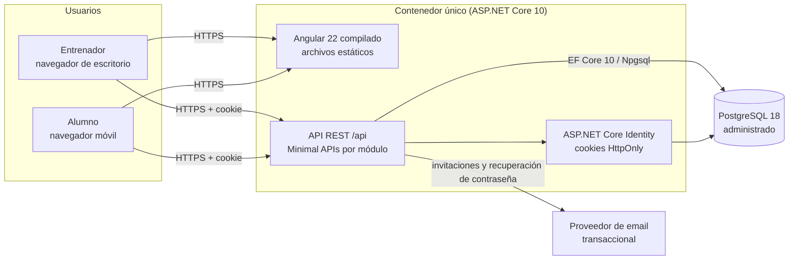
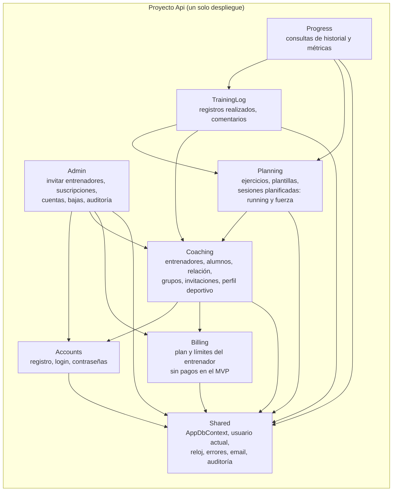
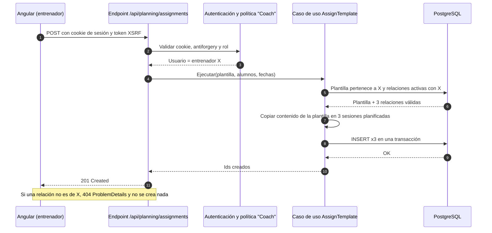

# Evaluación de arquitectura

> Plataforma SaaS para entrenadores de running y fuerza. Fase 1, aprobada el 29/10/2026 con cambios (D9, D10, D11; D6 en evaluación). Datos consultados el 26/10/2026.

## 1. Resumen ejecutivo

> **Actualización 29/10/2026:** Mauro aprobó la recomendación con tres cambios: contenido de sesiones normalizado (D9), panel mínimo de administración (D10) y datos de salud con consentimiento (D11). El hosting (D6) sigue en evaluación. Las secciones 9, 10, 14 y las ADR reflejan las decisiones definitivas; el resto conserva el análisis original.

**Recomendación:** un **monolito modular pragmático** en un único proyecto ASP.NET Core sobre **.NET 10 LTS**, con **Minimal APIs** agrupadas por módulo, **EF Core 10 + PostgreSQL 18**, y un frontend **Angular 22** servido desde el mismo origen que la API. La autenticación usa **ASP.NET Core Identity con cookies HttpOnly**, sin JWT. Todo se despliega como **un solo contenedor Docker** más una **base PostgreSQL administrada**, en el mismo proveedor y la misma región.

La hipótesis inicial de Mauro se sostiene en lo grueso. Los cambios que propongo son estos:

| Hipótesis inicial | Propuesta | Motivo principal |
|---|---|---|
| PostgreSQL o SQL Server | **PostgreSQL 18** | Hosting administrado más barato y con más proveedores, `jsonb` para el contenido de las sesiones y portabilidad total. EF Core funciona igual de bien con ambos. |
| Monolito modular | **Monolito modular en un solo proyecto .NET**, con límites por carpetas y tests de arquitectura | Da la separación de un monolito modular sin el costo de 6 u 8 proyectos y varios `DbContext`. |
| ASP.NET Core Web API | **Minimal APIs con route groups por módulo** (decisión a confirmar) | Encaja con la organización por funcionalidad y tiene OpenAPI integrado. Los controladores siguen siendo una opción válida si Mauro prefiere lo conocido. |
| Hosting sencillo | **Un contenedor (API + Angular compilado) + PostgreSQL administrado** | Mismo origen: cookies simples, sin CORS, un solo deploy. Costo estimado de unos USD 15 por mes en Render, con precios verificados. |
| Running y fuerza como módulos separados | **Un solo módulo de Planificación** con dos tipos de contenido | Comparten ciclo de vida (plantilla, asignación, edición, registro). Separarlos duplica código sin aislar nada útil. |

**Ventajas principales:** aprovecha la experiencia de Mauro en C#, EF y Angular; tiene un costo mensual bajo y predecible; ofrece una sola unidad de despliegue; y deja límites de módulo claros que permiten extraer piezas más adelante si alguna vez hace falta.

**Desventajas principales:** Minimal APIs, Signal Forms y PostgreSQL son terreno nuevo (curva corta pero real). La región de hosting más simple (Render, EE. UU.) agrega latencia desde Argentina. Identity propio implica operar el envío de emails y la recuperación de contraseñas.

**Riesgos más relevantes:** (1) fugas de datos entre entrenadores por errores de autorización, (2) un modelo de datos de sesiones demasiado rígido o demasiado genérico, (3) sobreingeniería que retrase el piloto, y (4) datos deportivos que podrían calificar como datos de salud bajo la Ley 25.326 (requiere verificación jurídica).

**Lo que no vale la pena resolver todavía:** panel de administración, pagos, PWA offline, SSR, microservicios, colas o mensajería, caché distribuida, multi-región, integraciones con Strava o Garmin.

> Convenciones de este informe: **[Verificado]** = comprobado en fuente oficial el 26/10/2026. **[Estimación]** = cálculo propio a partir de datos verificados. **[Opinión]** = criterio técnico. **[A verificar]** = supuesto pendiente de comprobar.

## 2. Contexto y restricciones

**Producto.** Aplicación web para entrenadores independientes de running que gestionan grupos y planifican entrenamientos personalizados de running y fuerza. Mercado inicial: Argentina. Ingresos: suscripción mensual del entrenador; los alumnos no pagan.

**Usuarios.** Entrenador (planifica, asigna, revisa), alumno (consulta, registra, comenta) y administrador de plataforma (alcance indefinido).

**Restricciones que guían la evaluación:**

- Desarrollador único con experiencia en C#, .NET Framework, ASP.NET Web API, SQL Server, EF, Angular, TypeScript, Git y CI/CD.
- Presupuesto de infraestructura bajo hasta validar mercado.
- Doble objetivo: negocio real y portfolio profesional. El portfolio se beneficia más de un sistema bien razonado y en producción que de patrones acumulados.
- Fuera del MVP: integraciones deportivas, apps nativas, chat en tiempo real, nutrición, IA, algoritmos avanzados, microservicios, Kubernetes, arquitecturas distribuidas.

**Estado inicial del entorno (inspección del 26/10/2026).** La carpeta de trabajo está vacía: no hay repositorio Git, ni `CLAUDE.md`, ni documentación previa, ni archivos del proyecto compartido. Se trata como proyecto nuevo, sin decisiones previas que respetar. No se creó ni modificó ningún archivo del proyecto.

**Supuestos de escala** [Estimación, a validar con Mauro]:

| Escenario | Entrenadores | Alumnos por entrenador | Usuarios totales | Sesiones registradas por mes |
|---|---|---|---|---|
| Piloto | 2 a 5 | 10 a 40 | ~200 | ~3.000 |
| Crecimiento inicial | 20 a 60 | 20 a 50 | ~3.000 | ~40.000 |

Con estos números, una sola instancia pequeña de aplicación y una base PostgreSQL chica sobran. El cuello de botella del proyecto es el tiempo de desarrollo, no la infraestructura.

## 3. Estado de la investigación y versiones verificadas

Todas las consultas se hicieron el **26 de octubre de 2026** sobre fuentes oficiales, salvo donde se indica.

| Componente | Versión evaluada | Estado y soporte | Fuente |
|---|---|---|---|
| .NET | **10 (LTS)**, último parche 10.0.14 del 25/10/2026 | Soporte hasta el **14/11/2028**. .NET 8 y .NET 9 terminan soporte el **10/11/2026**. | [Verificado] dotnet.microsoft.com |
| .NET 11 | RC3 (25/10/2026) | Lanzamiento previsto en .NET Conf, 10 al 13/11/2026. Es versión STS. | [Verificado] |
| EF Core | **10.0** | Soportado hasta el 10/11/2028 según la tabla de EF Core. EF Core 11 planificado para noviembre de 2026. | [Verificado] learn.microsoft.com |
| Npgsql EF Core provider | **10.0.3** (10/07/2026) | Requiere EF Core ≥ 10.0.4 y < 11. Existe 11.0.0-rc.2, no estable. | [Verificado] nuget.org |
| Angular | **22.0.x (Active)** | Publicado el 03/06/2026. Soporte activo hasta 06/2027 y LTS hasta 06/2028. Angular 21 está en LTS hasta 06/2027. Desde v22 las versiones mayores salen cada 12 meses. | [Verificado] angular.dev |
| Requisitos Angular 22 | Node 22.22.3+, 24.15+ o 26; TypeScript 6.0.x; RxJS 7.4+ | | [Verificado] angular.dev/reference/versions |
| Novedades Angular 22 | Signal Forms estable; `resource`/`httpResource` estables; OnPush por defecto | | Fuente secundaria (blog Ninja Squad); confirmar en Fase 2 |
| PostgreSQL | **18** (minor 18.6) | Fin de soporte comunitario: **14/11/2030**. PostgreSQL 19 está en RC1 (15/10/2026). | [Verificado] postgresql.org |
| SQL Server | 2025 (17.x) | Express: base de hasta 50 GB, buffer pool de 1.410 MB, hasta 4 núcleos. | [Verificado] learn.microsoft.com |
| OpenAPI en ASP.NET Core | `Microsoft.AspNetCore.OpenApi` integrado | La plantilla expone el documento JSON; la interfaz visual requiere un paquete de terceros (Swagger UI, Scalar, etc.). | [Verificado] learn.microsoft.com |

**Decisión de versiones** [Opinión]:

- **.NET 10 LTS ahora.** .NET 11 todavía no es GA y su proveedor Npgsql sigue en RC. Como las STS ahora tienen 24 meses de soporte (.NET 9 salió en noviembre de 2024 y termina en noviembre de 2026), .NET 11 terminaría cerca de .NET 10. No hay ganancia de soporte en esperar. Reevaluar la migración a .NET 11 en el primer trimestre de 2027, cuando Npgsql 11 sea estable, o saltar directamente a .NET 12 LTS (previsto para noviembre de 2027 según la cadencia anual).
- **Angular 22.** Es la versión activa y trae Signal Forms estable, algo relevante para el editor de rutinas.
- **PostgreSQL 18.** Ofrece la ventana de soporte más larga y la función nativa `uuidv7()` [A verificar en Fase 2 contra la documentación de la versión]. Confirmar que el proveedor elegido ofrece 18: Neon sí [Verificado]; Render [A verificar].

**Lo que no se pudo verificar:** los precios de Azure App Service, Azure Container Apps (por segundo) y Azure Static Web Apps Standard. Las páginas oficiales muestran marcadores de posición en lugar de importes y la API de precios no fue accesible desde este entorno. No se presentan importes inventados para esos servicios.

## 4. Evaluación del frontend

### 4.1. Qué exige la interfaz de este producto

Dos superficies muy distintas:

- **Entrenador (escritorio principalmente):** editor de sesiones con estructuras anidadas (bloques, repeticiones, series), vista semanal en matriz *alumnos × días*, asignación masiva con ajustes individuales, historial y gráficos.
- **Alumno (móvil principalmente):** ver "qué me toca hoy y esta semana", registrar lo realizado en pocos toques, leer comentarios.

El reto técnico real son los **formularios complejos y dinámicos** y una **vista de calendario a medida**. El rendimiento de renderizado, SEO o el tiempo de primera carga no son críticos: es una aplicación privada detrás de un login.

### 4.2. Angular frente a React

| Criterio | Angular 22 | React (con Vite, TanStack Query y React Hook Form) |
|---|---|---|
| Velocidad para Mauro | **Alta**: ya lo conoce | Media: hay que elegir y aprender router, estado de servidor, formularios y estructura |
| Formularios complejos | Signal Forms (estable en v22) o Reactive Forms tipados, ambos oficiales | React Hook Form o TanStack Form: muy buenos, pero de terceros |
| Estructura y convenciones | Opinada de serie: DI, router, HttpClient, guards, interceptores | Hay que armarla; más libertad, más decisiones |
| Calendario y gráficos | Menos componentes nativos; los genéricos en JS (Chart.js, ECharts) funcionan bien | Ecosistema más grande de componentes listos |
| Accesibilidad | Angular CDK y Material con a11y cuidada | Depende de la librería elegida (Radix, React Aria, etc.) |
| Pruebas | Integradas en el CLI; E2E con Playwright | Vitest, Testing Library y Playwright |
| Mantenimiento | Actualizaciones guiadas con `ng update` y migraciones automáticas; versión mayor anual | Muchas dependencias independientes que actualizar por separado |
| Valor de portfolio | Muy valorado en empresas con stack .NET (el perfil de Mauro) | Mayor mercado general |

**Conclusión** [Opinión]: **Angular**. React no aporta una ventaja concreta para este producto y le costaría a Mauro semanas de decisiones y aprendizaje que no validan el negocio. Angular ya no es la opción "pesada" de antes: con componentes standalone, signals y sin NgModules la cantidad de boilerplate es comparable a la de React. Reevaluar solo si en el futuro se decide compartir código con una app nativa en React Native.

### 4.3. Decisiones de implementación propuestas

| Tema | Propuesta | Tipo |
|---|---|---|
| Estructura | Componentes standalone, carpetas por funcionalidad (`coach/`, `athlete/`, `planning/`, `log/`, `progress/`), rutas con lazy loading por rol | Opinión |
| Estado | Signals y servicios por funcionalidad; `httpResource` para lecturas. **Sin NgRx**: no hay estado compartido complejo que lo justifique | Opinión |
| Formularios | Signal Forms para el editor de rutinas. Prototiparlo primero; si los arreglos anidados resultan incómodos, usar Reactive Forms tipados (`FormArray`), que es tecnología madura | Opinión, riesgo controlado |
| Componentes UI | Angular Material + CDK (accesibilidad, temas, drag & drop para reordenar bloques y ejercicios) | Opinión |
| Calendario | **Vista semanal propia con CSS Grid**. La vista central (matriz alumnos × días, semana del alumno) no encaja bien en librerías de calendario genéricas. Mes y año se posponen | Opinión |
| Gráficos | Chart.js (liviano y suficiente para volumen semanal, plan vs realizado, cargas). Versión y wrapper se eligen en Fase 2 | Opinión |
| Autenticación en la UI | Cookie de sesión manejada por el navegador; `HttpClient` con protección XSRF; guards solo para UX (la seguridad real está en la API) | Ver sección 10 |
| Responsive | Diseño mobile-first para las pantallas del alumno; desktop-first para el editor del entrenador | Opinión |
| Accesibilidad | Componentes de Material, contraste AA, navegación por teclado en el editor, unidades escritas (no solo íconos) | Opinión |

### 4.4. Web responsive o PWA

**Web responsive en el MVP; PWA instalable como mejora menor posterior.**

- Una PWA básica (manifest + service worker con `@angular/pwa`) da ícono en la pantalla de inicio y carga más rápida. El costo es bajo, pero agrega complejidad de caché y actualización de versiones. Conviene sumarla cuando los alumnos lo pidan, probablemente durante el piloto.
- **Registro offline: no.** Requiere cola de sincronización y resolución de conflictos. Reevaluar si el piloto muestra que los alumnos registran en lugares sin conexión.
- Notificaciones push: fuera del MVP. Su soporte en iOS tiene condiciones propias [A verificar si se plantea].

### 4.5. SSR y prerenderizado

**No.** La aplicación está detrás de un login, así que el SEO no aplica, y el SSR agrega un servidor Node, problemas de hidratación y otra superficie de despliegue. Si se necesita una landing comercial indexable, conviene hacerla como **sitio estático separado**, sin acoplarla a la app.

### 4.6. Riesgos del frontend

- Signal Forms es reciente: puede haber menos ejemplos y más cambios menores. Mitigación: prototipo temprano y alternativa con Reactive Forms.
- La vista matriz alumnos × días puede volverse lenta con muchos alumnos. Mitigación: paginar por grupo y cargar solo la semana visible.
- El cambio de Angular a una versión mayor por año obliga a reservar tiempo de actualización (normalmente horas, no días, gracias a `ng update`).

## 5. Evaluación del backend

### 5.1. Plataforma

**ASP.NET Core sobre .NET 10 LTS.** Es la opción con mejor relación entre experiencia previa, rendimiento, seguridad integrada (Identity, autorización por políticas, antiforgery, Data Protection) y despliegue en contenedores Linux. Pasar de .NET Framework a .NET moderno exige aprender el modelo de hosting, DI integrada, configuración por entorno y `async` de punta a punta, pero los conceptos de Web API se trasladan.

**Alternativas descartadas** [Opinión]: Node/NestJS o Python/Django no aportan una ventaja concreta para este producto y obligarían a reaprender todo el ecosistema. Django sí incluye un panel de administración, pero ese beneficio no compensa (ver sección 8 sobre el administrador).

### 5.2. Estilo de endpoints: no es lo mismo que arquitectura

El estilo de endpoints (controladores o Minimal APIs) es un detalle de la capa HTTP. Las dos opciones conviven con cualquier arquitectura: capas, monolito modular o Clean Architecture.

| Criterio | Controladores | Minimal APIs con route groups |
|---|---|---|
| Familiaridad para Mauro | **Alta** | Media (conceptos nuevos: `MapGroup`, `TypedResults`, filtros de endpoint) |
| Ceremonia | Clases, atributos, herencia de `ControllerBase` | Menor: un endpoint por caso de uso, agrupado por módulo |
| Organización por funcionalidad | Posible, pero tiende a "un controlador por entidad" | Natural: cada módulo registra sus propios grupos de rutas |
| OpenAPI | Integrado | Integrado, con tipos de respuesta inferidos de `TypedResults` |
| Validación | Model binding + DataAnnotations automáticas | Validación integrada para Minimal APIs en .NET 10 [A verificar el alcance exacto en Fase 2] |
| Filtros y autorización | Atributos y filtros MVC | `RequireAuthorization`, filtros de endpoint por grupo |
| Pruebas | Igual: pruebas de integración con `WebApplicationFactory` | Igual |
| Portfolio | Estándar | Muestra dominio de ASP.NET Core moderno |

**Recomendación** [Opinión]: **Minimal APIs organizadas por módulo**, con una clase de endpoints por módulo que define rutas y delega en clases de caso de uso simples. Es una decisión reversible y de bajo riesgo; si Mauro prefiere avanzar con lo que ya domina, los controladores son perfectamente válidos. **Decisión pendiente D2.**

### 5.3. Decisiones de implementación

| Tema | Propuesta | Por qué |
|---|---|---|
| Lógica de aplicación | Una clase por caso de uso (por ejemplo `AssignSessionToAthletes`) inyectada en el endpoint | Explícito y testeable, sin indirección |
| **MediatR / CQRS** | **No.** Separar lecturas (consultas proyectadas con `Select`) de escrituras como convención, sin bus ni librería | MediatR agrega indirección y desde 2025 tiene licencia comercial para ciertos usos [A verificar condiciones vigentes]. CQRS completo no aporta nada con una base y este volumen |
| Event sourcing | **No** | El historial se resuelve con versiones de la sesión planificada (sección 9.4) |
| Repositorios genéricos | **No.** Usar `DbContext` directamente en los casos de uso | `DbContext` ya es unidad de trabajo y repositorio; una capa genérica encima solo oculta EF |
| Validación | Validación integrada (DataAnnotations) para la forma de los datos; invariantes de negocio en las entidades o casos de uso. FluentValidation solo si las reglas crecen | Menos dependencias |
| Errores | `ProblemDetails` (RFC 9457) con `AddProblemDetails` + manejador global de excepciones; nunca exponer trazas en producción | Contrato de error uniforme para Angular |
| Documentación de API | `Microsoft.AspNetCore.OpenApi` + una interfaz visual (Scalar o Swagger UI) **solo en desarrollo**; documento OpenAPI generado en build y versionado en el repo | Permite detectar cambios de contrato en las revisiones |
| Cliente Angular | Generado desde OpenAPI (herramienta a elegir en Fase 2) o escrito a mano para un MVP chico | Evita desalineación de tipos |
| Logging | `ILogger` con salida JSON estructurada a consola (la recoge la plataforma). OpenTelemetry y APM se posponen | Sin costo extra |
| Fechas | `DateOnly` para el día planificado; `DateTimeOffset` UTC para marcas de tiempo; zona `America/Argentina/Buenos_Aires` como zona del entrenador | Un entrenamiento es "del martes", no "del martes 03:00 UTC" |
| Identificadores | `Guid` v7 (`Guid.CreateVersion7()`) | No enumerables y ordenables en índices. No reemplazan la autorización |

### 5.4. Resultado

ASP.NET Core 10, Minimal APIs por módulo (o controladores si se prefiere), casos de uso explícitos, EF Core directo, `ProblemDetails`, OpenAPI integrado, sin MediatR, CQRS ni event sourcing.

## 6. Comparación de bases de datos

### 6.1. Comparación técnica

| Criterio | PostgreSQL 18 | SQL Server 2025 / Azure SQL |
|---|---|---|
| EF Core 10 | Proveedor Npgsql 10.0.3 (mantenido por el equipo de Npgsql, muy maduro) | Proveedor oficial de Microsoft |
| Modelo relacional, FK, transacciones | Completo | Completo |
| Contenido semiestructurado (estructura de una sesión) | **`jsonb` indexable** (GIN), operadores ricos, mapeo JSON en EF | Tipo `json` nativo en 2025 y Azure SQL [A verificar soporte en EF Core 10 para el tipo nativo]; históricamente `nvarchar` + funciones JSON |
| Migraciones | EF Core Migrations, igual | EF Core Migrations, igual |
| Índices | B-tree, GIN, parciales, por expresión | B-tree, filtrados, columnstore |
| Reporting básico (volumen semanal, plan vs realizado) | Suficiente con SQL y vistas | Suficiente |
| Desarrollo local | Imagen Docker liviana, multiplataforma | Imagen Docker (Linux) o Express; Developer gratuito para desarrollo |
| Herramientas | psql, pgAdmin, DBeaver, Azure Data Studio, extensión de VS Code | SSMS (Windows), Azure Data Studio, VS Code |
| Licencia y portabilidad | Open source; **misma base en cualquier proveedor** | Licenciada; Express gratis con límite de 50 GB y 4 núcleos; hosting administrado casi exclusivo de Azure |
| Experiencia de Mauro | Baja (SQL estándar se traslada; cambian tipos, funciones y herramientas) | **Alta** |

### 6.2. Hosting administrado y costo (consultado el 26/10/2026, USD, sin impuestos)

| Opción | Costo mínimo útil | Límites relevantes | Estado |
|---|---|---|---|
| **Neon** (PostgreSQL serverless) — Launch | Pago por uso: USD 0,106 por CU-hora + USD 0,35 por GB-mes. Se suspende tras 5 min sin uso | PITR hasta 7 días; región **São Paulo (aws-sa-east-1)** disponible | [Verificado] |
| Neon — Free | USD 0 | 100 CU-h por proyecto, 1 GB, historial 6 h, siempre con scale-to-zero | [Verificado] |
| **Render Postgres** | USD 6/mes (256 MB RAM) o USD 19/mes (1 GB) + USD 0,30 por GB de disco | PITR de 3 días en el plan Hobby y 7 días en Pro; regiones solo en EE. UU., Europa y Singapur | [Verificado] |
| Render Postgres — Free | USD 0 | **Expira a los 30 días**, sin backups | [Verificado] (inservible para datos reales) |
| Supabase — Pro | Desde USD 25/mes | 8 GB incluidos, backups diarios 7 días; el Free se pausa tras 1 semana inactivo | [Verificado] |
| Fly.io Managed Postgres — Basic | USD 38/mes + USD 0,28 por GB | | [Verificado] |
| **Azure SQL Database — oferta gratuita** | USD 0 | 100.000 vCore-segundos/mes, 32 GB, **sin SLA**; Microsoft la recomienda para desarrollo y prueba de concepto | [Verificado] |
| Azure SQL serverless pago / Azure Database for PostgreSQL | No verificable hoy (precios no visibles en la página oficial) | | [A verificar] |

**Lectura de la oferta gratuita de Azure SQL** [Estimación]: 100.000 vCore-segundos son unas 27,8 horas de un vCore por mes. Con el mínimo serverless de 0,5 vCore son unas 55 horas de actividad mensuales, y cualquier conexión abierta impide la pausa. Alcanza para desarrollo; **no para un producto con usuarios reales todos los días**. Al agotarse, la base se pausa hasta el mes siguiente o pasa a facturarse.

### 6.3. Decisión

**PostgreSQL 18 + EF Core 10 + Npgsql** [Opinión con base verificada]. Motivos, en orden de peso:

1. **Costo y opciones de hosting.** Hay varios proveedores administrados con planes pagos de USD 6 a 25 por mes con backups. SQL Server administrado económico prácticamente se reduce a Azure, y su opción gratuita no sirve para producción.
2. **Restricciones avanzadas** (índices únicos parciales, FK compuestas, `CHECK`) que refuerzan en la base las reglas del modelo normalizado (D9). En la evaluación original este punto era `jsonb` para el contenido de las sesiones; con la decisión D9 deja de aplicar.
3. **Portabilidad.** Cambiar de proveedor es un `pg_dump`/`pg_restore`; no hay dependencia de un único vendedor.
4. **Portfolio.** Suma un motor muy demandado sin abandonar EF Core.

Lo que se pierde: la familiaridad con SQL Server y SSMS. Como se usa EF Core, el costo de aprendizaje se concentra en tipos (`timestamptz`, `jsonb`, `uuid`), mayúsculas y minúsculas en identificadores (usar la convención *snake_case* del proveedor) y herramientas.

**Condiciones que harían cambiar la decisión:** créditos de Azure gratuitos significativos (por ejemplo, un programa para startups), un socio o cliente que exija SQL Server, o la necesidad de reporting pesado con herramientas del ecosistema Microsoft.

### 6.4. Estrategia inicial de migraciones

- **EF Core Migrations, code-first**, con un único historial de migraciones para todo el monolito.
- Las migraciones se revisan en el pull request como código (incluido el SQL generado con `dotnet ef migrations script --idempotent`).
- **En producción no se aplican al arrancar la app.** Se ejecutan como paso explícito del pipeline antes de liberar la nueva versión (bundle de migraciones o script idempotente).
- Cambios compatibles hacia atrás (*expand/contract*): primero agregar columnas o tablas, desplegar, migrar datos y recién después eliminar lo viejo.
- Datos semilla mínimos (catálogo base de ejercicios) mediante migración o script versionado, nunca a mano.

## 7. Comparación de arquitecturas

### 7.1. Tres conceptos que se suelen mezclar

- **Separación por capas** (horizontal): presentación, lógica y persistencia. Responde a *qué tipo de código* es cada cosa.
- **Modularidad** (vertical): identidad, planificación, registro, etc. Responde a *qué parte del negocio* resuelve cada cosa y qué puede depender de qué.
- **Inversión de dependencias** (Clean o hexagonal): el núcleo de negocio define interfaces y la infraestructura las implementa. Responde a *hacia dónde apuntan* las dependencias.

Se pueden combinar. Un monolito modular puede tener capas livianas dentro de cada módulo y aplicar inversión de dependencias solo donde hay una dependencia externa real (envío de emails, proveedor de pagos, reloj).

### 7.2. Alternativas

**A. Aplicación por capas.** Proyectos `Api`, `Business`, `Data`, `Contracts`. Es lo que Mauro probablemente conoce de .NET Framework. Es simple al principio, pero con el tiempo la capa de negocio se vuelve un conjunto de servicios por entidad que se llaman entre sí sin límites. Cambiar "planificación" obliga a tocar las tres capas a la vez.

**B. Monolito modular.** Una unidad desplegable con módulos por capacidad de negocio y reglas explícitas de dependencia entre ellos. **Variante pragmática propuesta:** un único proyecto .NET con carpetas por módulo, un solo `DbContext`, y tests de arquitectura que impiden que un módulo use los internos de otro.

**C. Clean Architecture completa.** Proyectos `Domain`, `Application`, `Infrastructure`, `Web`, interfaces para cada repositorio, normalmente con MediatR y DTOs en cada frontera. Facilita las pruebas unitarias del dominio, pero para un CRUD con reglas moderadas multiplica archivos y mapeos. El riesgo de sobreingeniería es alto para un desarrollador solo que tiene que validar mercado.

### 7.3. Puntuación (1 = peor, 5 = mejor)

Las puntuaciones son **juicio técnico** para este contexto, no resultados de benchmarks. En los criterios negativos ("complejidad inicial", "riesgo de sobreingeniería", "costos"), 5 significa *menos* complejidad, *menos* riesgo y *menor* costo.

**Ponderación:** peso 3 a simplicidad, mantenibilidad y velocidad de validación comercial (lo que pidió Mauro); peso 2 a lo que importa a mediano plazo; peso 1 a lo que se compensa con estudio.

| Criterio | Peso | A. Capas | B. Monolito modular | C. Clean completa |
|---|---|---|---|---|
| Velocidad de implementación | 3 | 5 | 4 | 2 |
| Complejidad inicial (5 = baja) | 3 | 5 | 4 | 2 |
| Facilidad de aprendizaje | 1 | 5 | 4 | 2 |
| Mantenibilidad | 3 | 3 | 5 | 4 |
| Facilidad para pruebas | 2 | 3 | 4 | 5 |
| Claridad de responsabilidades | 2 | 3 | 5 | 4 |
| Riesgo de sobreingeniería (5 = bajo) | 3 | 5 | 4 | 2 |
| Facilidad para incorporar funcionalidades | 2 | 3 | 5 | 3 |
| Adecuación a un SaaS pequeño | 3 | 4 | 5 | 2 |
| Costos de desarrollo y operación (5 = bajos) | 2 | 5 | 5 | 3 |
| **Total ponderado (máx. 120)** | 24 | **99 (4,1)** | **108 (4,5)** | **68 (2,8)** |

La diferencia entre A y B es chica a propósito: un monolito modular bien hecho es casi tan simple como uno por capas. Lo que paga B es la mantenibilidad cuando el producto crece en funcionalidades (suscripciones, integraciones, métricas), que es justo lo que se espera si el negocio funciona.

### 7.4. Por qué B supera a las otras en este contexto

- Frente a **A**: cuesta casi lo mismo hoy, y evita el "todo depende de todo" que hace caras las reescrituras. Los módulos coinciden con el lenguaje del negocio (planificación, registro), lo que facilita razonar sobre cambios.
- Frente a **C**: obtiene la parte útil de Clean (dominio sin dependencias de HTTP, interfaces solo para servicios externos) sin la ceremonia de cuatro proyectos, repositorios por entidad y mapeos en cada frontera.

### 7.5. Qué cambiaría con muchos clientes

| Señal | Cambio posible |
|---|---|
| Los límites por carpeta se erosionan | Pasar módulos a proyectos separados (compilación como frontera) |
| Consultas de métricas lentas | Columnas resumen, vistas materializadas o una réplica de lectura |
| Tareas pesadas (importación de Strava, emails masivos) | Trabajos en segundo plano en el mismo proceso, y luego un worker separado con la misma base |
| Varios desarrolladores | Propietarios por módulo, contratos internos más formales |
| Un módulo con carga muy distinta (por ejemplo, ingesta de actividades) | Recién ahí, extraerlo como servicio |

### 7.6. Problemas que no vale la pena resolver todavía

Microservicios, mensajería y colas, caché distribuida, multi-región, sharding por entrenador, un `DbContext` por módulo, eventos de dominio publicados entre módulos, multi-tenancy con base por cliente, feature flags remotos. (El panel de administración figuraba en esta lista; Mauro optó por un panel mínimo, ver ADR-009.)

## 8. Arquitectura recomendada

### 8.1. Vista de alto nivel

Un contenedor ejecuta ASP.NET Core, que sirve la API bajo `/api` y los archivos compilados de Angular en el resto de las rutas. Navegador y API comparten origen, así que la cookie de sesión funciona sin CORS ni configuración entre dominios.



### 8.2. Módulos

Un único proyecto `.csproj` con esta organización:



**Reglas de dependencia:** cada módulo expone una fachada pequeña (por ejemplo, `ICoachingQueries.GetActiveRelationship(...)`) y los demás solo usan eso. Ningún módulo modifica tablas de otro. Las flechas no pueden formar ciclos. Las reglas se validan con tests de arquitectura (NetArchTest o ArchUnitNET, a elegir en Fase 2).

**¿Todos los módulos desde el día uno?**

| Módulo | Día uno | Comentario |
|---|---|---|
| Accounts | Sí | Base de todo |
| Coaching | Sí | Define la frontera de seguridad (la relación entrenador-alumno) |
| Planning | Sí | **Running y fuerza en el mismo módulo**: comparten plantilla, asignación, edición y estados. Lo que cambia es el contenido de la sesión, que se modela como tipos distintos (sección 9.3) |
| TrainingLog | Sí, desde el hito 3 | |
| Progress | Como carpeta de consultas de solo lectura | No necesita entidades propias |
| Billing | Mínimo: plan, estado de prueba y límite de alumnos | Pagos reales después del piloto |
| Admin | Sí, desde el hito 1 (invitar entrenadores es requisito del piloto) | Alcance cerrado (ADR-009) |

**Administrador de plataforma (D10, alternativa aprobada):** **panel mínimo** con un alcance cerrado: invitar entrenadores, gestionar el estado de su suscripción, deshabilitar y rehabilitar cuentas, gestionar invitaciones, procesar bajas de datos y consultar la auditoría. El administrador **no ve** sesiones, registros ni datos de salud, y no puede suplantar usuarios. Es la superficie más sensible de la aplicación, por eso exige 2FA, sesión corta y auditoría de todas sus acciones (sección 10).

### 8.3. Flujo de una solicitud

Ejemplo: un entrenador asigna una plantilla de fuerza a tres alumnos.



### 8.4. Estructura orientativa del repositorio (se define en Fase 2)

```text
/src/Api/                 Proyecto ASP.NET Core único
   Modules/Accounts/ Coaching/ Planning/ TrainingLog/ Progress/ Billing/
   Shared/                Persistencia, seguridad, errores, email
/tests/Api.UnitTests/     Dominio y casos de uso + tests de arquitectura
/tests/Api.IntegrationTests/  API + PostgreSQL real (Testcontainers)
/web/                     Aplicación Angular
/docs/architecture/       Estos documentos
```

Son tres proyectos .NET, no doce. Separar más se justifica solo si aparece una razón concreta (sección 7.5).

## 12. Estrategia de pruebas y calidad

El objetivo es probar a fondo lo que haría daño si falla: fugas de datos, historial alterado y asignaciones inválidas. **No se fija un porcentaje de cobertura como meta.** La cobertura se mira como señal de zonas sin probar, no como indicador de calidad.

### 12.1. Qué se prueba y cómo

| Nivel | Herramientas (a confirmar en Fase 2) | Qué cubre |
|---|---|---|
| Unitarias | xUnit | Reglas del dominio: copia de plantilla a sesión, cálculo de columnas resumen (distancia de un `Repeat` anidado, tonelaje), transiciones de estado, verificación de derechos del plan |
| Integración API + base | `WebApplicationFactory` + **Testcontainers con PostgreSQL 18 real** (no proveedor en memoria: no reproduce `jsonb`, transacciones ni restricciones) | Endpoints de punta a punta, migraciones aplicadas desde cero, filtros globales, restricciones únicas |
| **Autorización (matriz)** | Tests de integración parametrizados | Cada endpoint × {anónimo, alumno propio, alumno ajeno, entrenador propio, entrenador ajeno} → resultado esperado. Un endpoint nuevo sin fila en la matriz hace fallar el test |
| Arquitectura | NetArchTest o ArchUnitNET | Un módulo no usa los internos de otro; el dominio no depende de ASP.NET |
| Contrato de API | Documento OpenAPI generado en build y versionado | El diff en el PR muestra cambios de contrato; el cliente de Angular se regenera desde ahí |
| Frontend unitarias | Vitest o el runner por defecto de Angular 22 [A verificar] | Lógica del editor de rutinas, conversiones ritmo y velocidad, formateo de unidades |
| E2E | Playwright | 3 a 5 flujos críticos (ver 12.2), contra la app real con base de prueba |
| Exploratorias | Manual, durante el piloto | Usabilidad móvil del alumno, ergonomía del editor, casos raros de planificación |

### 12.2. Escenarios de mayor riesgo (automatizados sí o sí)

1. Un entrenador no puede leer ni modificar alumnos, grupos, plantillas, sesiones ni registros de otro entrenador, ni adivinando IDs (debe responder 404).
2. Un alumno no puede ver ni modificar el plan ni los registros de otro alumno, aunque compartan grupo.
3. Modificar una plantilla no cambia sesiones ya asignadas; modificar una sesión planificada ya registrada crea una versión nueva y no cambia la versión registrada.
4. No se puede asignar una sesión a un usuario sin relación **activa** con el entrenador (relación terminada, invitada o de otro entrenador: rechazo).
5. No se puede agregar a un grupo a un alumno de otro entrenador.
6. Una invitación vencida, usada, revocada o usada con otro email no da acceso.
7. Los permisos se aplican en el backend: los tests de API se hacen sin UI.
8. Con la suscripción vencida, las escrituras se bloquean y las lecturas siguen.
9. Solo un `PlatformAdmin` con 2FA accede al área de administración, y ningún endpoint de administración devuelve sesiones, registros ni datos de salud.
10. Sin consentimiento vigente no se pueden guardar datos de salud; revocarlo los borra; un entrenador sin relación activa no los ve.
11. Editar una sesión cuya versión ya fue registrada crea una versión nueva y deja intacta la registrada.

**Flujos E2E:** el entrenador invita y el alumno acepta; el entrenador crea una plantilla de intervalos y la asigna a un grupo con un ajuste individual; el alumno ve la semana, registra la sesión y el entrenador comenta; el entrenador ve plan vs realizado.

### 12.3. Calidad de código

- `.editorconfig` + `dotnet format` verificado en CI; analizadores de .NET con *warnings as errors* en CI; `Nullable` habilitado.
- Angular: ESLint (angular-eslint) + Prettier; TypeScript en modo `strict`.
- Revisión propia por PR aunque se trabaje solo: el PR documenta el porqué.

### 12.4. Errores, logging y configuración

- **Errores:** `ProblemDetails` uniforme; errores de validación con detalle por campo; 404 para recursos ajenos; 500 sin detalles y con id de correlación para buscar en logs.
- **Logging:** estructurado (JSON), nivel Information en producción, sin datos sensibles; logs de seguridad (login fallido, invitación rechazada, acceso denegado) identificables.
- **Health checks:** `/health` con verificación de base para el deploy.
- **Configuración por entorno:** `appsettings.json` sin secretos + `appsettings.Development.json` + variables de entorno en producción; opciones validadas al arrancar (`ValidateOnStart`) para fallar rápido si falta una cadena de conexión o la clave del proveedor de email.
- **Migraciones:** test de integración que aplica todas las migraciones sobre una base vacía; revisión del SQL generado en cada PR.

### 12.5. Qué queda para el piloto

Usabilidad, claridad de textos, velocidad percibida en móviles reales con 4G, flujos poco frecuentes (reprogramar una semana entera, alumno que cambia de grupo) y la latencia real desde Argentina.

## 13. Riesgos técnicos

Probabilidad e impacto son estimaciones cualitativas (Baja, Media, Alta).

| Riesgo | Prob. | Impacto | Consecuencia para el MVP | Mitigación | Cuándo |
|---|---|---|---|---|---|
| **Sobreingeniería** | Media | Alto | El piloto se retrasa meses | Tres proyectos .NET, sin MediatR ni CQRS; lista explícita de "no ahora" (7.6); cada hito termina en algo usable | Siempre; revisar en cada hito |
| **Modelo de datos incorrecto** (sesiones demasiado rígidas o demasiado genéricas) | Media | Alto | Reescritura del editor y migraciones dolorosas | Contrato de API anidado independiente de las tablas; validar el modelo con 2 o 3 entrenadores reales mostrándoles planes en papel o maqueta **antes de codificar el editor** | Fase 2, antes del hito 2 |
| **Complejidad de la personalización** | Alta | Medio | Editor confuso o con errores de "cambié uno y cambiaron todos" | Copiar al asignar; edición individual explícita; tests del escenario 12.2.3 | Hito 2 |
| **Fugas entre entrenadores** | Media | **Crítico** | Pérdida de confianza y posible problema legal | Filtro global + verificación por recurso + matriz de autorización automatizada + 404 | Desde el primer endpoint |
| **Costos de infraestructura** | Baja | Bajo | Sorpresas en la factura | Planes de precio fijo; alertas de facturación; revisar consumo mensual | Mensual |
| **Dependencia de proveedores** | Media | Medio | Cambio de precios o cierre de un PaaS chico | Docker + PostgreSQL estándar + backups propios fuera del proveedor; nada de servicios propietarios | Desde el despliegue inicial |
| **Dificultades de mantenimiento** (desarrollador único) | Media | Medio | El código se vuelve frágil cuando crece | Módulos con fronteras testeadas, tests de alto valor, ADRs, actualizaciones de dependencias automatizadas | Continuo |
| **Complejidad de suscripciones** | Media | Medio | Integración de pagos más larga de lo previsto (webhooks, reintentos, impuestos) | Diseño de derechos desde el día uno; pagos manuales durante el piloto; integración como proyecto propio después | Post-piloto |
| **Cambios en los requisitos** | Alta | Medio | Trabajo descartado | Hitos chicos, feedback de entrenadores cada 2 semanas, no construir lo que no pidió nadie | Continuo |
| **Datos de salud y cumplimiento legal** | Media | Alto | Obligaciones no previstas o campos que no conviene pedir | Consulta jurídica antes del piloto; minimizar datos sensibles; consentimiento | Antes del piloto |
| **Curva de aprendizaje** (PostgreSQL, Minimal APIs, Signal Forms, .NET moderno) | Media | Bajo | Avance inicial más lento | Hito 0 dedicado a la base técnica; alternativas conocidas disponibles (controladores, Reactive Forms) | Hito 0 |
| **Latencia desde Argentina** (si se elige Render) | Media | Bajo | App percibida como lenta en móvil | Medir en el piloto; plan de migración a São Paulo listo | Piloto |
| **Panel de administración comprometido** (D10) | Baja | **Crítico** | Acceso a cuentas de todos los entrenadores | 2FA obligatoria, rol solo por CLI, alcance sin datos de entrenamiento ni salud, auditoría, tests de autorización | Hito 1 |
| **Datos de salud** (D11) | Media | Alto | Obligaciones legales adicionales; impacto mayor ante una filtración | Tabla aislada, consentimiento versionado, exclusión de logs y administración, revisión legal | Antes del piloto |
| **Complejidad del modelo normalizado** (D9) | Media | Medio | Más código de mapeo y copias profundas; errores al versionar | Contrato de API anidado independiente del almacenamiento; tests de copia y versionado; límites de tamaño | Hito 2 |
| **Envío de emails** (invitaciones en spam) | Media | Medio | Los alumnos no pueden entrar | Dominio propio con SPF, DKIM y DMARC; enlace de invitación copiable para enviar por WhatsApp | Hito 1 |

### 13.1. Decisiones difíciles de revertir y decisiones que pueden esperar

**Difíciles de revertir (decidir bien ahora):** motor de base de datos; la relación entrenador-alumno como frontera de datos; copiar al asignar y versionar las sesiones registradas; Identity propio frente a proveedor externo (migrar usuarios después es caro); el entrenador como cliente de la suscripción; formato de identificadores (GUID).

**Reversibles o posponibles:** controladores o Minimal APIs; proveedor de hosting y región; librerías de gráficos y componentes; PWA; staging; `TrainingBlock`; 2FA; Row Level Security; proveedor de email; separar módulos en proyectos.

## 14. Decisiones (resueltas el 29/10/2026)

Mauro respondió las decisiones el 29/10/2026. Esta tabla registra la resolución definitiva y su consecuencia.

| # | Decisión | Resolución | Consecuencia |
|---|---|---|---|
| D1 | Frontend | **Aprobada la recomendación:** Angular 22, web responsive, sin SSR ni PWA en el MVP | ADR-001 aceptada |
| D2 | Estilo de endpoints | **Aprobada la recomendación:** Minimal APIs por módulo | ADR-002 aceptada |
| D3 | Base de datos | **Aprobada la recomendación:** PostgreSQL 18 + EF Core 10 (Npgsql) | ADR-003 aceptada |
| D4 | Arquitectura | **Aprobada la recomendación:** monolito modular en un proyecto + tests de arquitectura | ADR-004 aceptada |
| D5 | Autenticación | **Aprobada la recomendación:** ASP.NET Core Identity + cookies, mismo origen | ADR-005 aceptada |
| D6 | Hosting y región | **Sin decisión, en evaluación** | ADR-006 queda propuesta. El diseño de Fase 2 es independiente del proveedor (imagen Docker + PostgreSQL estándar); solo el paso de despliegue del pipeline espera esta decisión |
| D7 | Alumno con varios entrenadores | **Aprobada la recomendación:** modelo N:M, MVP con un entrenador activo por alumno | ADR-008 aceptada |
| D8 | Alta de entrenadores en el piloto | **Aprobada la recomendación:** solo por invitación | Las invitaciones de entrenador las emite el panel de administración (D10) |
| D9 | Contenido de sesiones | **Alternativa: modelo totalmente normalizado** | ADR-007 reemplazada. Pasos de running, ejercicios y series pasan a tablas propias; el historial se protege con versiones de la sesión planificada en lugar de instantáneas JSON (sección 9.4). Se gana consulta directa del progreso por ejercicio |
| D10 | Administración | **Alternativa: panel mínimo de administración** | Nuevo módulo Admin (ADR-009) con alcance acotado, 2FA obligatoria y auditoría. Sin acceso a entrenamientos ni datos de salud |
| D11 | Datos de salud en el perfil | **Alternativa: incluir datos de salud con consentimiento** | Nueva ADR-010: tabla separada, consentimiento explícito y versionado, revocable con borrado. **La revisión legal sigue siendo requisito antes del piloto** |
| D12 | Idioma y unidades | **Aprobada la recomendación:** solo español, sistema métrico, ritmo en min/km, zona horaria de Argentina | Sin i18n en el MVP |
| D13 | Repositorio y CI | **Aprobada la recomendación:** GitHub + GitHub Actions | Repositorio privado `MauroPolizzi/saas-run-fit`, rama principal `master` (05/11/2026) |

## 16. Referencias oficiales

Consultadas el **26/10/2026**. Versiones, soporte y precios pueden cambiar.

**Plataformas y versiones**

- .NET y .NET Core, política de soporte: <https://dotnet.microsoft.com/en-us/platform/support/policy/dotnet-core>
- EF Core, novedades y soporte por versión: <https://learn.microsoft.com/en-us/ef/core/what-is-new/>
- Npgsql.EntityFrameworkCore.PostgreSQL (NuGet): <https://www.nuget.org/packages/Npgsql.EntityFrameworkCore.PostgreSQL>
- Angular, versiones y lanzamientos: <https://angular.dev/reference/releases>
- Angular, compatibilidad de Node, TypeScript y RxJS: <https://angular.dev/reference/versions>
- Novedades de Angular 22 (fuente secundaria): <https://blog.ninja-squad.com/2026/06/03/what-is-new-angular-22.0>
- PostgreSQL, política de versiones: <https://www.postgresql.org/support/versioning>
- SQL Server 2025, ediciones y límites: <https://learn.microsoft.com/en-us/sql/sql-server/editions-and-components-of-sql-server-2025>

**ASP.NET Core**

- Identity para backends de SPA (`MapIdentityApi`, cookies y tokens): <https://learn.microsoft.com/en-us/aspnet/core/security/authentication/identity-api-authorization>
- OpenAPI en ASP.NET Core: <https://learn.microsoft.com/aspnet/core/fundamentals/openapi/overview>

**Hosting y servicios**

- Neon, precios: <https://neon.com/pricing>
- Neon, regiones: <https://neon.com/docs/introduction/regions>
- Neon, versiones de Postgres: <https://neon.com/docs/postgresql/postgres-version-support>
- Render, precios: <https://render.com/pricing>
- Render, plan gratuito y límites: <https://render.com/docs/free>
- Render, regiones: <https://render.com/docs/regions>
- Fly.io, precios: <https://docs.fly.io/about/pricing>
- Railway, planes: <https://docs.railway.com/pricing/plans>
- Supabase, precios: <https://supabase.com/pricing>
- Azure SQL Database, oferta gratuita: <https://learn.microsoft.com/en-us/azure/azure-sql/database/free-offer>
- Azure Container Apps, precios: <https://azure.microsoft.com/en-us/pricing/details/container-apps/>
- Azure App Service Linux, precios: <https://azure.microsoft.com/en-us/pricing/details/app-service/linux/>
- Azure Static Web Apps, planes: <https://learn.microsoft.com/en-us/azure/static-web-apps/plans>
- Cloudflare Pages, límites: <https://developers.cloudflare.com/pages/platform/limits>
- Resend, precios: <https://resend.com/pricing>
- Mercado Pago, suscripciones: <https://www.mercadopago.com.ar/developers/es/docs/subscriptions/resources/tutorial-videos>

**Marco legal (verificar con un profesional)**

- Resolución AAIP 47/2018: <https://www.argentina.gob.ar/normativa/nacional/resolución-47-2018-312662/texto>
- Situación de la Ley 25.326 en 2026 (Diario Judicial): <https://www.diariojudicial.com/news-103126-proteccion-de-datos-personales-sigue-siendo-suficiente-la-ley-25326-en-2026>
