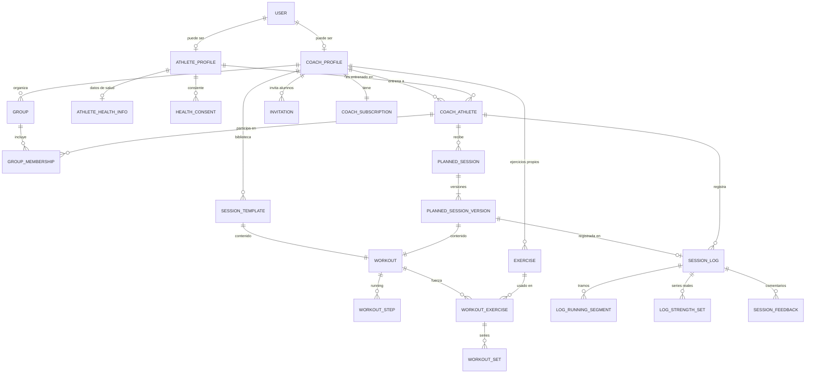

# Modelo de dominio

> Plataforma SaaS para entrenadores de running y fuerza. Fase 1, aprobada el 29/10/2026 con cambios (D9, D10, D11; D6 en evaluación). Datos consultados el 26/10/2026.

## 9. Diseño conceptual del dominio

Modelo conceptual, actualizado el 29/10/2026 con las decisiones D9 (contenido normalizado), D10 (panel de administración) y D11 (datos de salud con consentimiento). El esquema físico detallado está en el diseño técnico (`docs/design/data-model.md`).

### 9.1. Entrenadores, grupos y alumnos

**Un usuario no es un rol.** `User` es la cuenta (email, contraseña, nombre). Ser entrenador o alumno se expresa con perfiles y relaciones:

- `CoachProfile` existe si el usuario es entrenador. Es la **raíz de los datos del negocio** (el "inquilino").
- `AthleteProfile` existe si el usuario es alumno y guarda su perfil deportivo.
- **`CoachAthlete`** es la relación entre un entrenador y un alumno, con estado (`Active`, `Ended`), fechas y notas privadas del entrenador. **Todo lo planificado y registrado cuelga de esta relación.**
- `Group` pertenece a un entrenador. `GroupMembership` une un grupo con una relación `CoachAthlete` **del mismo entrenador**; una FK compuesta lo garantiza en la base.

| Alternativa | Complejidad | Evaluación |
|---|---|---|
| Alumno pertenece a un único entrenador (FK directa) | Mínima | Rígida: cambiar de entrenador obliga a decidir qué pasa con el historial |
| **Relación explícita, N:M posible, MVP con un solo entrenador activo por alumno** | Baja | **Aprobada (D7).** La restricción del MVP es un índice único parcial sobre relaciones activas |
| N:M completo desde el día uno | Media | La UI del alumno necesitaría contexto de entrenador en todas las pantallas |

Un alumno puede estar en **varios grupos del mismo entrenador**. El grupo es una herramienta de organización y asignación masiva, **no un contenedor de planificación**: las sesiones se asignan siempre a personas.

### 9.2. Plantillas y personalización

| Concepto | Qué es | ¿Cambia? |
|---|---|---|
| **`SessionTemplate`** | Sesión reutilizable en la biblioteca del entrenador; apunta a su propio `Workout` | Sí, libremente. Cambiarla **no afecta** a nada ya asignado |
| **`PlannedSession`** | Sesión concreta para *un* alumno en *una* fecha. Al asignar, el `Workout` de la plantilla se **copia en profundidad** (`SourceTemplateId` queda como referencia) | Sí. El entrenador la adapta para ese alumno sin tocar a los demás |
| **`PlannedSessionVersion`** | Cada versión del contenido de una sesión planificada; apunta a un `Workout` propio | Se edita en el lugar mientras nadie la registró. **Bloqueada** desde que un registro la referencia |
| **`SessionLog`** | Lo que el alumno hizo, con referencia a la versión exacta que tenía delante | No retroactivamente: los cambios del plan crean una versión nueva y no tocan la registrada |

**Asignar a un grupo** = crear una `PlannedSession` por alumno seleccionado (en una transacción), cada una con su copia del `Workout`, y un `AssignmentBatch` común para saber qué se asignó junto.

### 9.3. Running y fuerza (modelo normalizado, D9)

El contenido de cualquier sesión cuelga de un **`Workout`**, que pertenece a una plantilla o a una versión de sesión planificada (nunca a las dos).

**Compartido** (en `PlannedSession` y `Workout`): fecha (`DateOnly`), orden en el día, tipo (`Running`, `Strength`), título, notas, estado, duración estimada, RPE objetivo, y **totales calculados** al guardar (distancia, duración, cantidad de series).

**Running:** `WorkoutStep` forma un árbol de un solo nivel de anidamiento.

- Paso simple: tipo (`WarmUp`, `Work`, `Recovery`, `CoolDown`, `Rest`), duración por distancia (m), por tiempo (s) o abierta, objetivo por ritmo (rango en s/km), zona de FC (1 a 5), RPE (1 a 10) o ninguno, notas.
- Paso `Repeat`: cantidad de repeticiones y pasos hijos (`ParentStepId`). Una repetición no puede contener otra repetición. Ejemplo: 6 × (1000 m a 4:10–4:20 /km + 2 min de trote).

**Fuerza:** `WorkoutExercise` (ejercicio del catálogo, nombre copiado, etiqueta de superserie como `A1`/`A2`, notas) y `WorkoutSet` (repeticiones o tiempo, carga en kg, % de 1RM, RPE o peso corporal, descanso en segundos, tempo).

**Objetos de valor** (columnas, no tablas): `Distance` (m), `Duration` (s), `PaceRange` (s/km), `HeartRateZone`, `Rpe`, `Load` (tipo + valor).

**Con identidad propia:** `Exercise` (catálogo global con `CoachId` nulo, o propio del entrenador), porque se reutiliza, se busca y se grafica su progreso.

### 9.4. Historial

1. Las plantillas se copian en profundidad al asignar; nunca se referencian en vivo.
2. `SessionLog` referencia la `PlannedSessionVersion` sobre la que se registró. Esa versión queda bloqueada.
3. Editar una sesión planificada con versión bloqueada crea una versión nueva (copia del `Workout` + cambios) y la marca como actual. La UI puede mostrar "el plan cambió después del registro".
4. El detalle real se guarda en `LogRunningSegment` (vueltas o tramos, opcionalmente vinculados al paso planificado) y `LogStrengthSet` (series reales, vinculadas al ejercicio y opcionalmente a la serie planificada).
5. Las métricas se calculan desde los registros, no desde lo planificado.
6. Al terminar una relación, sus datos quedan en solo lectura para el entrenador durante el período de conservación y el alumno conserva su historial.
7. No hay borrado físico en operaciones normales; solo la baja de cuenta y la revocación del consentimiento de salud borran datos.

### 9.5. Plan de entrenamiento

Sin entidad `TrainingPlan` en el MVP. La planificación semanal es una consulta por rango de fechas sobre `PlannedSession`. Un `TrainingBlock` liviano puede sumarse después si los entrenadores lo piden.

### 9.6. Métricas de progreso

Son consultas, no entidades: volumen semanal, cumplimiento, plan vs realizado, tonelaje y RPE promedio, y, gracias al modelo normalizado, **progreso por ejercicio** (carga máxima y volumen por semana).

### 9.7. Suscripciones

- El **entrenador** es el cliente; la suscripción cuelga de `CoachProfile`.
- `CoachSubscription`: plan, estado (`Trial`, `Active`, `PastDue`, `Canceled`), fin de prueba, fin de período, proveedor y referencia (vacíos por ahora).
- Un único punto de verificación de derechos (`IEntitlements`).
- Suscripción vencida: **solo lectura**, sin borrar datos.
- Durante el piloto, el estado se gestiona desde el panel de administración (D10).

### 9.8. Administración y salud

- **`PlatformInvitation`:** invitación de entrenador emitida por un administrador (D8 + D10).
- **`AuditEvent`:** registro inmutable de acciones administrativas, consentimientos y eventos de seguridad.
- **`AthleteHealthInfo`:** FC máxima y en reposo, peso, lesiones y observaciones médicas, en tabla separada. Solo existe con un **`HealthConsent`** vigente (versión del texto aceptado, fecha de otorgamiento, fecha de revocación). Revocar borra `AthleteHealthInfo`.

### 9.9. Diagrama de relaciones

`SESSION_LOG` puede existir sin sesión planificada (entrenamiento no planificado). Las tablas de contenido y registro llevan `coach_id` desnormalizado para filtrar por entrenador con índices y filtros globales.
