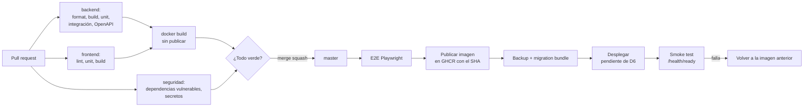

# Pipeline CI/CD

> Plataforma SaaS para entrenadores de running y fuerza. Fase 2, diseño técnico aprobado (Fase 3 iniciada el 05/11/2026). Versiones verificadas el 29/10/2026.

## 12. Pipeline CI/CD inicial

### 12.1. Flujo

### 12.2. `ci.yml` (cada PR y cada push a `master`)

| Job | Pasos |
|---|---|
| `backend` | `actions/setup-dotnet` con `global.json` → `dotnet restore --locked-mode` → `dotnet format --verify-no-changes` → `dotnet build -warnaserror` → tests unitarios → tests de integración (Docker disponible en runners Ubuntu de GitHub para Testcontainers) → generar OpenAPI y comparar con el versionado → SQL idempotente de migraciones como artefacto |
| `frontend` | `actions/setup-node` con Node 24 → `npm ci` → lint → tests → `ng build` de producción |
| `docker` | Construye la imagen multi-etapa (necesita `backend` y `frontend` en verde); no publica en PR |
| `security` | `dotnet list package --vulnerable --include-transitive` y `npm audit --audit-level=high`; escaneo de secretos (nativo de GitHub si el repositorio lo permite, o una acción tipo gitleaks) |

### 12.3. `deploy.yml` (push a `master`, después de CI)

1. E2E con Playwright contra la imagen recién construida y un PostgreSQL efímero.
2. Publicar la imagen en GitHub Container Registry con etiquetas `sha-<commit>` y `master`.
3. Backup lógico de la base (`pg_dump`) si el commit incluye migraciones.
4. Ejecutar el *migration bundle* contra producción.
5. Desplegar la imagen. **Se completa al decidir D6** (por ejemplo, deploy hook de Render o `flyctl deploy`). Hasta entonces el job `deploy` está desactivado: se habilita con la variable de repositorio `DEPLOY_ENABLED=true`.
6. *Smoke test* contra `/health/ready` y un login de prueba con una cuenta técnica.
7. Si falla, redesplegar la imagen anterior (las migraciones son compatibles hacia atrás).

Se protege con un *environment* `production` de GitHub con aprobación manual opcional al principio.

### 12.4. Imagen Docker

- Etapa 1: Node 24 → `npm ci` + `ng build`.
- Etapa 2: SDK .NET 10 → `dotnet publish` en modo Release; copia el build de Angular a `wwwroot`.
- Etapa 3: imagen de runtime `aspnet:10.0.13-noble-chiseled-extra` (*chiseled* con ICU y tzdata) [Verificado en la Fase 3], **usuario no root**, solo los archivos publicados.
- `HEALTHCHECK` contra `/health/live` con `dotnet RunFitPlatform.Api.dll healthcheck` (la imagen no tiene shell ni curl). Sin secretos en la imagen.

### 12.5. Gobierno del repositorio

- `master` protegida: CI obligatoria, sin push directo, merge por *squash*.
- Dependabot para NuGet, npm, GitHub Actions y la imagen base, agrupado semanalmente.
- Acciones de GitHub fijadas por SHA.
- Secretos: `PROD_DB_CONNECTION` (migraciones), credenciales de despliegue según D6. Nunca en el código.
- El repositorio es **privado**: los minutos de Actions tienen cuota mensual según el plan de la cuenta [A verificar la cuota vigente]. El escaneo de secretos se hace con gitleaks en un contenedor, porque el nativo de GitHub en repositorios privados requiere GitHub Advanced Security.
- Dependabot usa `cooldown` de 14 días para respetar la regla de dependencias.
