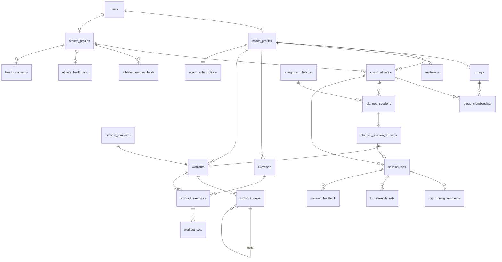

# Modelo de datos

> Plataforma SaaS para entrenadores de running y fuerza. Fase 2, diseño técnico pendiente de aprobación. Versiones verificadas el 29/10/2026.

## 8. Modelo de datos inicial

Diseño lógico para PostgreSQL 18 con el contenido de sesiones **normalizado** (D9). Los tipos son los de PostgreSQL; las columnas `created_at` y `updated_at` (`timestamptz`) existen en todas las tablas mutables y se omiten en las listas. Todas las claves `id` son `uuid` v7 generados en la aplicación.

### 8.1. Diagrama

### 8.2. Esquema `identity` (Accounts)

| Tabla | Columnas principales | Notas |
|---|---|---|
| `users` y tablas estándar de Identity (`roles`, `user_roles`, `user_claims`, `user_logins`, `user_tokens`, `role_claims`) | `id`, `email`, `normalized_email` (único), `password_hash`, `security_stamp`, `two_factor_enabled`, `lockout_end`, `access_failed_count` + **`display_name` varchar(80)**, **`is_disabled` bool**, **`last_seen_at`** | `AppUser : IdentityUser<Guid>` |
| `data_protection_keys` | `id`, `friendly_name`, `xml` | Claves de Data Protection |

### 8.3. Esquema `coaching`

| Tabla | Columnas | Restricciones e índices |
|---|---|---|
| `coach_profiles` | `user_id` PK/FK, `bio` varchar(1000), `city` varchar(80), `time_zone` varchar(64) | |
| `athlete_profiles` | `user_id` PK/FK, `birth_date` date null, `sex` varchar(16) null, `height_cm` smallint null, `level` varchar(16), `main_goal` varchar(300), `weekly_days_available` smallint null | `ck` rangos |
| `athlete_personal_bests` | `id`, `athlete_id` FK, `distance_m` int, `time_s` int, `achieved_on` date null | `ux (athlete_id, distance_m)` |
| `athlete_health_info` | `athlete_id` PK/FK, `max_hr` smallint, `resting_hr` smallint, `weight_kg` numeric(5,1), `injuries` varchar(2000), `medical_notes` varchar(2000), `updated_by` uuid | Solo existe con consentimiento vigente |
| `health_consents` | `id`, `athlete_id` FK, `consent_version` varchar(20), `granted_at`, `revoked_at` null | `ux (athlete_id) WHERE revoked_at IS NULL` |
| `coach_athletes` | `id`, `coach_id` FK, `athlete_id` FK, `status` varchar(16) (`active`, `ended`), `started_at`, `ended_at` null, `coach_notes` varchar(4000) | `ux (id, coach_id)` (para FK compuestas); `ux (athlete_id) WHERE status='active'` (**un entrenador activo por alumno, D7**); `ux (coach_id, athlete_id) WHERE status='active'` |
| `groups` | `id`, `coach_id` FK, `name` varchar(60), `description` varchar(500), `archived_at` null | `ux (id, coach_id)`; `ux (coach_id, lower(name)) WHERE archived_at IS NULL` |
| `group_memberships` | `group_id`, `coach_athlete_id`, `coach_id`, `joined_at` | PK `(group_id, coach_athlete_id)`; **FK `(group_id, coach_id)` → `groups(id, coach_id)`** y **FK `(coach_athlete_id, coach_id)` → `coach_athletes(id, coach_id)`**: la base impide mezclar entrenadores |
| `invitations` | `id`, `coach_id` FK, `email` varchar(254) (normalizado), `group_id` null, `token_hash` bytea(32), `status`, `expires_at`, `accepted_at` null, `accepted_by` null, `send_count` smallint | `ux (token_hash)`; `ux (coach_id, email) WHERE status='pending'`; FK `(group_id, coach_id)` → `groups` |

### 8.4. Esquema `planning`

| Tabla | Columnas | Restricciones e índices |
|---|---|---|
| `exercises` | `id`, `coach_id` null (null = catálogo global), `name` varchar(80), `category` varchar(24), `equipment` varchar(60), `description` varchar(1000), `video_url` varchar(500), `archived_at` null | `ux (coach_id, lower(name))` con `NULLS NOT DISTINCT` [A verificar sintaxis en EF; si no, índice parcial para el catálogo global] |
| `workouts` | `id`, `coach_id` FK, `kind` varchar(16) (`running`, `strength`), `estimated_duration_s` int null, `target_rpe` smallint null, `notes` varchar(2000), `total_distance_m` int, `total_duration_s` int, `total_sets` smallint | `ux (id, coach_id)`. Los totales se calculan en el dominio al guardar |
| `workout_steps` | `id`, `workout_id` FK, `coach_id`, `parent_step_id` null FK, `position` smallint, `step_type` varchar(16) (`warmUp`, `work`, `recovery`, `coolDown`, `rest`, `repeat`), `repeat_count` smallint null, `duration_type` varchar(16) null (`distance`, `time`, `open`), `distance_m` int null, `duration_s` int null, `target_type` varchar(16) (`none`, `pace`, `hrZone`, `rpe`), `pace_min_s_per_km` smallint null, `pace_max_s_per_km` smallint null, `hr_zone` smallint null, `rpe` smallint null, `notes` varchar(500) | `ux (workout_id, parent_step_id, position)`; `ck` coherencia: `repeat` exige `repeat_count` y no tiene duración; un paso simple exige `duration_type`; `pace_min ≤ pace_max`. **Una repetición no contiene otra** (validado en dominio) |
| `workout_exercises` | `id`, `workout_id` FK, `coach_id`, `exercise_id` FK, `exercise_name` varchar(80) (copia), `position` smallint, `group_label` varchar(4) null, `notes` varchar(500) | `ux (workout_id, position)` |
| `workout_sets` | `id`, `workout_exercise_id` FK, `coach_id`, `position` smallint, `reps` smallint null, `duration_s` int null, `load_type` varchar(16) (`none`, `kg`, `percent1rm`, `rpe`, `bodyweight`), `load_value` numeric(6,2) null, `rest_s` smallint null, `tempo` varchar(4) null | `ux (workout_exercise_id, position)`; `ck` reps o duración presentes |
| `session_templates` | `id`, `coach_id` FK, `title` varchar(100), `kind`, `workout_id` FK único, `archived_at` null, `xmin` (concurrencia) | FK `(workout_id, coach_id)` → `workouts(id, coach_id)` |
| `assignment_batches` | `id`, `coach_id`, `source_template_id` null, `group_id` null, `created_by` | |
| `planned_sessions` | `id`, `coach_id`, `coach_athlete_id`, `scheduled_on` date, `position_in_day` smallint, `kind`, `title` varchar(100), `status` varchar(16) (`planned`, `completed`, `skipped`, `cancelled`), `current_version_id` FK, `source_template_id` null, `assignment_batch_id` null, `xmin` | **FK `(coach_athlete_id, coach_id)` → `coach_athletes(id, coach_id)`**; `ix (coach_id, scheduled_on)`; `ix (coach_athlete_id, scheduled_on)` |
| `planned_session_versions` | `id`, `planned_session_id` FK, `coach_id`, `version_number` smallint, `workout_id` FK único, `is_locked` bool, `created_by` | `ux (planned_session_id, version_number)` |

**Copia profunda:** asignar o versionar copia `workouts` + `workout_steps` (respetando `parent_step_id`) + `workout_exercises` + `workout_sets` con ids nuevos, en la misma transacción. Una sesión típica son 5 a 40 filas.

**Versionado:** editar una sesión cuya versión actual tiene `is_locked = false` modifica esa versión. Si está bloqueada (ya hay un registro que la referencia), se crea `version_number + 1` y se actualiza `current_version_id`.

### 8.5. Esquema `training_log`

| Tabla | Columnas | Restricciones e índices |
|---|---|---|
| `session_logs` | `id`, `coach_id`, `coach_athlete_id`, `planned_session_id` null, `planned_version_id` null FK, `performed_on` date, `kind`, `completion` varchar(16) (`completed`, `partial`), `actual_distance_m` int null, `actual_duration_s` int null, `avg_hr` smallint null, `rpe` smallint null, `athlete_notes` varchar(2000), `xmin` | FK `(coach_athlete_id, coach_id)` → `coach_athletes`; `ux (planned_session_id) WHERE planned_session_id IS NOT NULL` (un registro por sesión planificada); `ix (coach_athlete_id, performed_on)` |
| `log_running_segments` | `id`, `session_log_id` FK, `coach_id`, `position` smallint, `planned_step_id` null FK, `repetition_index` smallint null, `distance_m` int null, `duration_s` int null, `avg_hr` smallint null, `notes` varchar(300) | `ux (session_log_id, position)` |
| `log_strength_sets` | `id`, `session_log_id` FK, `coach_id`, `exercise_id` FK, `exercise_name` varchar(80), `planned_set_id` null FK, `position` smallint, `reps` smallint null, `duration_s` int null, `load_kg` numeric(6,2) null, `rpe` smallint null, `completed` bool | `ix (exercise_id, session_log_id)` para progreso por ejercicio |
| `session_feedback` | `id`, `session_log_id` FK, `coach_id`, `author_id`, `author_role` varchar(16), `body` varchar(2000), `edited_at` null, `deleted_at` null | `ix (session_log_id, created_at)` |

### 8.6. Esquemas `billing` y `admin`

| Tabla | Columnas | Notas |
|---|---|---|
| `billing.coach_subscriptions` | `coach_id` PK/FK, `plan_code` varchar(32), `status` varchar(16), `trial_ends_at` null, `current_period_end` null, `provider` null, `provider_reference` null, `xmin` | Catálogo de planes y límites en código |
| `admin.platform_invitations` | `id`, `email`, `role` (`coach`, `platformAdmin`), `token_hash`, `status`, `expires_at`, `created_by`, `accepted_at` null, `accepted_by` null | Mismas reglas de token que `invitations` |
| `admin.audit_events` | `id`, `occurred_at`, `actor_id` null, `actor_role`, `action` varchar(64), `target_type` varchar(32), `target_id` uuid null, `reason` varchar(500) null, `details` jsonb null | Solo inserción; nunca guarda valores de salud ni contraseñas. `ix (occurred_at)`, `ix (target_type, target_id)` |

### 8.7. Filtros globales de EF Core

Filtros **nombrados** (EF Core 10 [Verificado]), para poder desactivar uno sin desactivar los demás:

| Filtro | Entidades | Expresión (conceptual) |
|---|---|---|
| `DataScope` (entrenador) | `groups`, `invitations`, `exercises` propios, `session_templates`, `assignment_batches` | `CoachId == scope.CoachId` (el catálogo global de ejercicios se incluye con `CoachId == null`) |
| `DataScope` (relación) | `coach_athletes`, `planned_sessions`, `planned_session_versions`, `session_logs`, `group_memberships`, `session_feedback`, `log_*` | `CoachId == scope.CoachId || scope.CoachAthleteIds.Contains(CoachAthleteId)` (las tablas sin `coach_athlete_id` lo resuelven por `coach_id` y el padre) |
| `DataScope` (contenido) | `workouts`, `workout_steps`, `workout_exercises`, `workout_sets` | `CoachId == scope.CoachId || scope.AthleteCoachIds.Contains(CoachId)`. Un alumno solo llega a estas filas a través de sus sesiones planificadas, que ya están filtradas |
| `NotArchived` | `groups`, `exercises`, `session_templates` | `ArchivedAt == null` (se desactiva para ver archivados) |

Los datos de salud **no** dependen solo del filtro: los endpoints de salud verifican relación activa y consentimiento explícitamente.

### 8.8. Lo que queda fuera del modelo inicial

`TrainingBlock`, notificaciones, archivos adjuntos, integración con Strava o Garmin, pagos reales, auditoría de lectura de datos de salud.

## 9. Estrategia de migraciones

| Tema | Decisión |
|---|---|
| Herramienta | EF Core Migrations, code-first, **un único historial** en `Persistence/Migrations` para todo el monolito |
| Tabla de historial | `public.__ef_migrations_history` |
| Nombres | Descripción en PascalCase con el verbo del cambio: `InitialIdentity`, `AddPlanningWorkouts`, `AddHealthConsents` |
| Revisión | Cada PR con migraciones adjunta el SQL idempotente generado (`dotnet ef migrations script --idempotent`) como artefacto de CI, para revisarlo antes de aprobar |
| Desarrollo | `Database:MigrateOnStartup=true` solo en Development; también se puede usar `dotnet ef database update` |
| Tests | Los tests de integración crean la base **aplicando todas las migraciones desde cero**, no con `EnsureCreated`. Así una migración rota falla en CI |
| Producción | **Nunca al arrancar la aplicación.** El pipeline construye un *migration bundle* (`dotnet ef migrations bundle`) y lo ejecuta antes de liberar la nueva versión. Dónde corre (runner de GitHub contra la base, o comando previo al despliegue en el proveedor) depende de D6 |
| Compatibilidad | *Expand/contract*: primero se agregan columnas o tablas compatibles, se despliega el código que usa ambas formas, se migran datos, y en una versión posterior se elimina lo viejo. Así la versión anterior de la app sigue funcionando si hay que volver atrás |
| Reversión | No se usan migraciones `Down` en producción: se corrige hacia adelante. Antes de una migración riesgosa, el pipeline toma un backup (`pg_dump`) |
| Datos semilla | El catálogo global de ejercicios (unos 40) se inserta con una migración de datos con ids fijos. Los planes de suscripción viven en código |
| Restricciones no expresables en EF | Índices parciales, FK compuestas y `CHECK` se declaran con la API de EF cuando existe y con `migrationBuilder.Sql` cuando no, siempre dentro de la migración |
