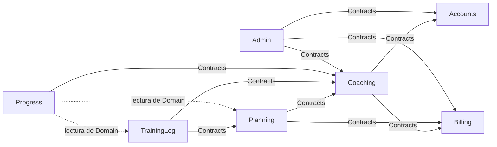

# Diseño técnico

> Plataforma SaaS para entrenadores de running y fuerza. Fase 2, diseño técnico pendiente de aprobación. Versiones verificadas el 29/10/2026.

## 1. Punto de partida

### 1.1. Decisiones aplicadas

Este diseño parte de las decisiones de Mauro del 29/10/2026 (registradas en `architecture-decision-records.md`):

| Tema | Decisión vigente |
|---|---|
| Frontend | Angular 22, web responsive, sin SSR ni PWA |
| Backend | ASP.NET Core sobre .NET 10 LTS, Minimal APIs por módulo |
| Datos | PostgreSQL 18, EF Core 10, proveedor Npgsql, **contenido de sesiones normalizado** (D9) |
| Arquitectura | Monolito modular en un proyecto, tests de arquitectura |
| Autenticación | ASP.NET Core Identity + cookies, mismo origen |
| Alumnos | Relación entrenador-alumno N:M, un entrenador activo por alumno en el MVP |
| Entrenadores | Alta solo por invitación, emitida desde el **panel de administración** (D8 + D10) |
| Salud | Datos de salud **con consentimiento** explícito, versionado y revocable (D11) |
| Idioma | Español, sistema métrico, ritmo en min/km, zona `America/Argentina/Buenos_Aires` |
| Repositorio | GitHub + GitHub Actions |

### 1.2. Cuestiones abiertas

| Cuestión | ¿Bloquea este diseño? | ¿Cuándo hace falta? |
|---|---|---|
| **D6. Hosting y región** | No. El diseño es independiente del proveedor: imagen Docker, PostgreSQL estándar y migraciones como paso explícito | Antes de escribir el job de despliegue y antes de cerrar el Hito 0 |
| **Repositorio público o privado**, y crearlo en GitHub | No | Antes de la Fase 3 (estructura inicial). Esta sesión no puede crear repositorios: Mauro lo crea y conecta GitHub |
| **Nombre técnico de la solución** | No; se usa `CoachPlatform` como nombre provisorio | Antes de la Fase 3, porque fija namespaces y nombres de proyectos |
| **Proveedor de email** | No; se diseña una interfaz `IEmailSender` | Hito 0. Recomendación: Resend (plan gratuito de 3.000 emails por mes y 100 por día, verificado el 26/10/2026) |
| **Revisión legal** de datos de salud y política de privacidad | No para diseñar; sí para el piloto | Antes del piloto |

### 1.3. Versiones de referencia (verificadas el 29/10/2026)

| Componente | Versión | Nota |
|---|---|---|
| .NET SDK / runtime | 10.0 (último parche 10.0.14) | Fijado con `global.json` |
| EF Core | 10.0.x | |
| Npgsql.EntityFrameworkCore.PostgreSQL | 10.0.3 | Requiere EF Core ≥ 10.0.4 |
| EFCore.NamingConventions | 10.0.1 | Convención *snake_case* para PostgreSQL |
| PostgreSQL | 18 (18.6) | Imagen `postgres:18` en local y en tests |
| Angular | 22.0.x | Requiere Node 22.22.3+, 24.15+ o 26 y TypeScript 6.0.x |
| Node.js | 24 (LTS) | Dentro del rango soportado por Angular 22 |
| Testcontainers.PostgreSql | 4.16.0 | Incluye build para net10.0 |
| xUnit v3 | 4.0.2 | |
| Scalar.AspNetCore | 2.x | Publicado el 28/10/2026; en la Fase 3 se fija una versión con al menos dos semanas de antigüedad |

Regla general para la Fase 3: cada dependencia se fija a una versión exacta publicada hace al menos dos semanas, con gestión centralizada de paquetes (`Directory.Packages.props`) y `package-lock.json`.

## 2. Estructura de directorios

```text
/
├── src/
│   └── CoachPlatform.Api/                 Único proyecto de producción
│       ├── Program.cs                     Composición: servicios, middleware, módulos
│       ├── Modules/
│       │   ├── Accounts/                  Login, contraseñas, 2FA, invitaciones (aceptación)
│       │   ├── Coaching/                  Perfiles, relación entrenador-alumno, grupos, invitaciones, salud
│       │   ├── Planning/                  Ejercicios, plantillas, workouts, sesiones planificadas, asignaciones
│       │   ├── TrainingLog/               Registros realizados, tramos, series reales, comentarios
│       │   ├── Progress/                  Consultas de historial y métricas (solo lectura)
│       │   ├── Billing/                   Plan, estado de suscripción, derechos
│       │   └── Admin/                     Panel mínimo: entrenadores, invitaciones, cuentas, bajas, auditoría
│       ├── Shared/
│       │   ├── Persistence/               AppDbContext, convenciones, interceptores, filtros
│       │   ├── Security/                  Usuario actual, alcance de datos, políticas, antiforgery
│       │   ├── Web/                       ProblemDetails, filtros de endpoint, convenciones de rutas
│       │   ├── Auditing/                  Escritura de AuditEvent
│       │   ├── Email/                     IEmailSender e implementaciones
│       │   └── Cli/                       Comandos de mantenimiento (crear administrador)
│       ├── Persistence/Migrations/        Historial único de migraciones
│       ├── openapi/v1.json                Contrato generado en build y versionado
│       ├── appsettings.json
│       └── appsettings.Development.json
├── tests/
│   ├── CoachPlatform.Api.UnitTests/       Dominio, casos de uso puros, tests de arquitectura
│   └── CoachPlatform.Api.IntegrationTests/ API + PostgreSQL real (Testcontainers), matriz de autorización
├── web/                                   Aplicación Angular 22
│   ├── src/app/
│   │   ├── core/                          Sesión, guards, manejo de errores, tipos de API generados
│   │   ├── shared/                        Componentes y pipes de unidades (ritmo, distancia, duración)
│   │   └── features/
│   │       ├── auth/                      Login, recuperación, aceptar invitación, 2FA
│   │       ├── coach/                     Inicio, alumnos, grupos, invitaciones, perfil
│   │       ├── planning/                  Ejercicios, plantillas, editor de workout, semana
│   │       ├── athlete/                   Mi semana, detalle, registrar, historial, perfil, salud
│   │       ├── progress/                  Gráficos
│   │       └── admin/                     Panel de administración (carga diferida)
│   ├── e2e/                               Tests Playwright
│   └── proxy.conf.json                    Proxy del servidor de desarrollo hacia la API
├── docs/
│   ├── architecture/                      Documentos de la Fase 1
│   ├── design/                            Documentos de esta fase
│   └── runbooks/                          Procedimientos (crear administrador, restaurar backup)
├── .github/
│   ├── workflows/ci.yml
│   ├── workflows/deploy.yml               Se completa al decidir D6
│   └── dependabot.yml
├── Dockerfile                             Build multi-etapa: Angular + .NET → imagen de runtime
├── compose.yaml                           PostgreSQL 18 y Mailpit para desarrollo local
├── CoachPlatform.slnx                     Solución en formato `.slnx`, el formato por defecto de `dotnet new sln` desde el SDK 10 [Verificado]
├── global.json                            Versión del SDK
├── Directory.Build.props                  Nullable, analizadores, warnings como errores en CI
├── Directory.Packages.props               Versiones centralizadas de NuGet
├── .editorconfig
├── .gitignore
├── .dockerignore
└── README.md
```

**Por qué así:** tres proyectos .NET (uno de producción y dos de tests). La aplicación Angular vive en el mismo repositorio para versionar API y cliente juntos. `compose.yaml` levanta solo la infraestructura local; la API y Angular corren desde el IDE o la terminal para depurar con comodidad.

### 2.1. Estructura interna de un módulo

```text
Modules/Planning/
├── PlanningModule.cs          AddPlanningModule(services) y MapPlanningEndpoints(routes)
├── Contracts/                 Lo único visible para otros módulos (interfaces + DTOs)
│   └── IPlanningQueries.cs
├── Domain/                    Entidades, objetos de valor y reglas; sin ASP.NET ni EF
│   ├── Workout.cs
│   ├── WorkoutStep.cs
│   └── PlannedSession.cs
├── Features/                  Un archivo por caso de uso (request, response, handler, endpoint)
│   ├── Templates/CreateTemplate.cs
│   ├── Templates/UpdateTemplate.cs
│   ├── Assignments/AssignTemplate.cs
│   └── PlannedSessions/UpdatePlannedSession.cs
└── Persistence/               IEntityTypeConfiguration<T> del módulo
    └── WorkoutConfiguration.cs
```

Cada archivo de `Features` contiene el contrato HTTP del caso de uso, su validación declarativa, la clase que lo ejecuta y el método que registra la ruta. Leer un caso de uso es leer un archivo.

### 2.2. Ejemplo orientativo de un caso de uso

Pseudocódigo para fijar la convención; el código real se escribe en la Fase 3 y los hitos.

```csharp
public static class AssignTemplate
{
    [ValidatableType]
    public sealed record Request(
        Guid TemplateId,
        DateOnly ScheduledOn,
        [MinLength(1), MaxLength(100)] IReadOnlyList<Guid> CoachAthleteIds);

    public sealed record Response(Guid BatchId, IReadOnlyList<Guid> PlannedSessionIds);

    public static void Map(RouteGroupBuilder coach) =>
        coach.MapPost("/assignments", Handle).WithName("AssignTemplate");

    static async Task<Results<Created<Response>, NotFound, ProblemHttpResult>> Handle(
        Request request, Handler handler, CancellationToken ct) => await handler.Execute(request, ct);

    public sealed class Handler(AppDbContext db, IDataScope scope, ICoachingQueries coaching, TimeProvider clock)
    {
        public async Task<Results<Created<Response>, NotFound, ProblemHttpResult>> Execute(Request r, CancellationToken ct)
        {
            // 1. Plantilla del entrenador actual (el filtro global ya restringe por entrenador)
            // 2. Relaciones activas del entrenador para todos los ids pedidos; si falta una → 404
            // 3. Derechos del plan (Billing) → 403 con código si no corresponde
            // 4. Copia profunda del workout por alumno + AssignmentBatch, en una transacción
        }
    }
}
```

## 3. Límites de módulos y dependencias permitidas

### 3.1. Responsabilidades y datos de cada módulo

| Módulo | Responsabilidad | Tablas propias (esquema PostgreSQL) |
|---|---|---|
| Accounts | Usuarios, login, logout, contraseñas, 2FA, aceptación de invitaciones (crea la cuenta) | `identity.*` (tablas de Identity), `identity.data_protection_keys` |
| Coaching | Perfiles de entrenador y alumno, marcas personales, relación entrenador-alumno, grupos, invitaciones de alumnos, salud y consentimientos | `coaching.*` |
| Planning | Catálogo de ejercicios, workouts (pasos, ejercicios, series), plantillas, sesiones planificadas y sus versiones, asignaciones | `planning.*` |
| TrainingLog | Registros realizados, tramos de running, series reales, comentarios | `training_log.*` |
| Progress | Consultas agregadas de historial y métricas | Ninguna (solo lectura) |
| Billing | Suscripción del entrenador, catálogo de planes (en código), derechos | `billing.*` |
| Admin | Invitaciones de entrenador, operaciones de soporte, consulta de auditoría | `admin.*` |
| Shared | Infraestructura transversal: `AppDbContext`, alcance de datos, errores, email, auditoría | `admin.audit_events` lo escribe `Shared/Auditing` |

### 3.2. Grafo de dependencias



Todas las flechas apuntan además a `Shared`, que no aparece para no ensuciar el diagrama.

### 3.3. Reglas (validadas por tests de arquitectura)

1. Un módulo solo usa de otro módulo los tipos de su carpeta `Contracts`.
2. **Excepción documentada:** `Progress` puede leer entidades de `TrainingLog.Domain` y `Planning.Domain`, solo con consultas `AsNoTracking`, porque su única función es agregar datos para gráficos. No puede escribir.
3. **`Admin` no puede depender de `Planning`, `TrainingLog` ni `Progress`**, ni de los tipos de salud de `Coaching`. Esto materializa que el administrador no ve entrenamientos ni datos de salud (ADR-009).
4. `Domain` no depende de `Microsoft.AspNetCore.*` ni de `Microsoft.EntityFrameworkCore.*`.
5. `Shared` no depende de ningún módulo (salvo el registro de configuraciones de EF por ensamblado).
6. No hay ciclos entre módulos.
7. Entre módulos no hay propiedades de navegación de EF: se referencian por id. Las FK existen en la base, pero el código de un módulo no carga entidades de otro.
8. Un módulo solo modifica sus propias tablas. Si necesita que otro módulo cambie algo, llama a una operación expuesta en `Contracts` dentro de la misma transacción.

### 3.4. Comunicación entre módulos

- **Llamadas síncronas en proceso** a interfaces de `Contracts` (por ejemplo `ICoachingQueries.GetActiveRelationshipsAsync(coachId, ids)`).
- **Sin eventos de dominio ni bus** en el MVP. Si dos módulos deben cambiar juntos, el caso de uso orquesta ambos dentro de la transacción del `AppDbContext` compartido.
- Reevaluar eventos en proceso si aparecen efectos secundarios en cadena (por ejemplo, notificaciones al registrar una sesión).

### 3.5. Frontend

- `features/*` no importan entre sí; lo compartido va a `shared/` (UI) o `core/` (sesión, API).
- `features/admin` se carga de forma diferida y solo para el rol `PlatformAdmin`; no se incluye en el bundle inicial.
- Se valida con reglas de ESLint de restricción de imports (por ejemplo `no-restricted-imports` por carpeta).

## 4. Convenciones de nombres

### 4.1. .NET

| Elemento | Convención | Ejemplo |
|---|---|---|
| Namespace raíz | `CoachPlatform.Api` (provisorio) | `CoachPlatform.Api.Modules.Planning.Features.Templates` |
| Caso de uso | Verbo + sustantivo, clase estática contenedora | `AssignTemplate`, `RecordSessionLog`, `RevokeHealthConsent` |
| Request / Response | Records anidados `Request`, `Response` | `AssignTemplate.Request` |
| Ejecutor | Clase anidada `Handler`, registrada como scoped | `AssignTemplate.Handler` |
| Fachadas | `I<Módulo>Queries`, `I<Módulo>Commands` | `ICoachingQueries` |
| Entidades | Sustantivo singular en inglés | `PlannedSession`, `WorkoutStep` |
| Enums | Singular, valores en PascalCase | `SessionStatus.Completed` |
| Tests | `Método_Escenario_Resultado` o frase descriptiva | `Assign_WithAthleteOfOtherCoach_Returns404` |

El código y la base usan **inglés** (términos del dominio en inglés: *coach*, *athlete*, *workout*). La interfaz y la documentación están en **español**.

### 4.2. API HTTP

- Prefijo `/api`. Recursos en plural y *kebab-case*: `/api/coach/planned-sessions`.
- Prefijo por perspectiva cuando cambia el alcance de datos: `/api/coach/...` (entrenador), `/api/me/...` (alumno autenticado), `/api/admin/...` (administración). Es más fácil de auditar que endpoints compartidos con lógica por rol.
- JSON en *camelCase*; enums como **strings** en *camelCase* (`"warmUp"`, `"completed"`).
- Fechas de calendario como `"yyyy-MM-dd"` (`DateOnly`); instantes en ISO 8601 UTC (`2026-10-29T17:32:03Z`).
- Unidades fijas en el contrato: metros, segundos, segundos por km, kg. El formateo (km, min/km) es responsabilidad del frontend.
- Nombres de rutas (`WithName`) iguales al caso de uso, para que el cliente generado tenga nombres estables.

### 4.3. Base de datos

- *snake_case* para tablas y columnas (EFCore.NamingConventions), tablas en plural: `planning.workout_steps`.
- Un esquema por módulo: `identity`, `coaching`, `planning`, `training_log`, `billing`, `admin`.
- Clave primaria `id uuid` (UUID v7 generado en la aplicación con `Guid.CreateVersion7()`). Tablas de unión con clave compuesta.
- FK `<entidad>_id`; índices `ix_<tabla>_<columnas>`; únicos `ux_...`; checks `ck_<tabla>_<regla>`.
- Columnas de auditoría simples: `created_at`, `updated_at` (`timestamptz`), asignadas por un interceptor con `TimeProvider`.

### 4.4. Angular

- Archivos en *kebab-case* según la guía de estilo oficial vigente de Angular [A verificar en la Fase 3 la convención de sufijos de la versión 22].
- Componentes standalone; prefijo de selector `cp-`.
- Un servicio de datos por funcionalidad (`planning-api.ts`) que usa los tipos generados desde OpenAPI.
- Señales con nombres sustantivos (`sessions`, `selectedWeek`); `computed` para derivados.

### 4.5. Git

- Rama principal `main` protegida; ramas cortas `feat/...`, `fix/...`, `chore/...`, `docs/...`.
- Commits con Conventional Commits (`feat(planning): asignar plantilla a grupo`).
- Merge por *squash* tras CI en verde.

## 5. Configuración por entorno

### 5.1. Entornos

| Entorno | Uso | Base de datos | Email |
|---|---|---|---|
| `Development` | Máquina de Mauro | PostgreSQL 18 en `compose.yaml` | Mailpit local (captura los emails, no los envía) |
| `Testing` | Tests de integración y E2E en CI | PostgreSQL 18 vía Testcontainers | Implementación en memoria que guarda los emails para inspeccionarlos en los tests |
| `Production` | Usuarios reales | PostgreSQL administrado (proveedor según D6) | Proveedor real (recomendado: Resend) |

Un entorno `Staging` se agrega solo cuando haya usuarios que no deban ver errores; no forma parte del MVP inicial.

### 5.2. Fuentes de configuración

| Fuente | Qué contiene | ¿Secretos? |
|---|---|---|
| `appsettings.json` | Valores por defecto seguros para producción (niveles de log, límites, duraciones) | **No** |
| `appsettings.Development.json` | Cadena de conexión al PostgreSQL local del `compose.yaml`, Mailpit, migración al arrancar | No (credenciales locales de desarrollo, sin valor fuera de la máquina) |
| User Secrets | Cualquier credencial real que se use en desarrollo | Sí, fuera del repositorio |
| Variables de entorno | Toda la configuración de producción | Sí, gestionadas por el proveedor |
| Secretos de GitHub Actions | Credenciales del pipeline (registro de imágenes, despliegue, base para migraciones) | Sí |

Formato de variables: `ConnectionStrings__Default`, `Email__ApiKey`, `App__PublicBaseUrl`.

### 5.3. Opciones tipadas y validadas al arrancar

Cada sección se enlaza a una clase de opciones con validación (`ValidateDataAnnotations` + `ValidateOnStart`), así la aplicación **no arranca** con configuración incompleta:

| Sección | Campos principales |
|---|---|
| `App` | `PublicBaseUrl` (para armar enlaces de emails), `TimeZone` (por defecto `America/Argentina/Buenos_Aires`) |
| `ConnectionStrings` | `Default` |
| `Database` | `MigrateOnStartup` (solo `true` en Development), `CommandTimeoutSeconds` |
| `Auth` | Duración de sesión, duración de sesión de administrador, vencimiento de invitaciones (7 días), intentos antes del bloqueo |
| `Email` | `Provider` (`Mailpit`, `InMemory`, `Resend`), `From`, `ApiKey` |
| `RateLimiting` | Límites por política (login, recuperación, invitaciones, administración) |
| `ReverseProxy` | Redes de confianza para `X-Forwarded-For` y `X-Forwarded-Proto` (depende de D6) |

### 5.4. Frontend

Angular no tiene configuración por entorno con secretos. Como la API está en el mismo origen, todas las llamadas usan rutas relativas (`/api/...`). En desarrollo, `ng serve` usa `proxy.conf.json` para reenviar `/api` a Kestrel, de modo que el navegador también ve un único origen y las cookies funcionan igual que en producción.

## 6. Manejo de errores y logging

### 6.1. Contrato de errores

Todas las respuestas de error usan `ProblemDetails` (RFC 9457) con dos extensiones fijas:

```json
{
  "type": "https://tools.ietf.org/html/rfc9110#section-15.5.5",
  "title": "No encontrado",
  "status": 404,
  "traceId": "00-4bf92f3577b34da6a3ce929d0e0e4736-00f067aa0ba902b7-01",
  "code": "planning.planned_session_not_found"
}
```

| Situación | Estado | `code` (ejemplos) |
|---|---|---|
| Datos con forma inválida | 400 con `errors` por campo | `validation.failed` |
| Regla de negocio incumplida | 422 | `planning.relationship_inactive`, `coaching.group_member_of_other_coach` |
| Recurso inexistente **o ajeno** | 404 | `<módulo>.<recurso>_not_found` |
| Sin sesión | 401 | `auth.unauthenticated` |
| Sin permiso por rol o plan | 403 | `auth.forbidden`, `billing.athlete_limit_reached`, `billing.read_only` |
| Conflicto de concurrencia o unicidad | 409 | `concurrency.conflict`, `coaching.group_name_taken` |
| Límite de peticiones | 429 | `rate_limit.exceeded` |
| Error inesperado | 500, sin detalles internos | `server.error` |

Angular traduce cada `code` a un mensaje en español; el texto del servidor no se muestra tal cual.

### 6.2. Cómo se producen

- Los resultados esperados se devuelven como `TypedResults` desde los handlers (`NotFound`, `ValidationProblem`, `Problem` con código). **No se usan excepciones para el flujo normal.**
- Un `IExceptionHandler` global traduce lo inesperado: `DbUpdateConcurrencyException` → 409, violaciones de índices únicos conocidos de PostgreSQL → 409 con código, cualquier otra excepción → 500 con `traceId`.
- La autenticación por cookie se configura para devolver **401/403** en `/api` en lugar de redirigir a una página de login (por defecto, el esquema de cookies redirige).
- Concurrencia optimista con la columna de sistema `xmin` de PostgreSQL en plantillas, sesiones planificadas, grupos y perfiles; el cliente envía la versión que leyó.

### 6.3. Logging

| Aspecto | Decisión |
|---|---|
| Proveedor | `ILogger` integrado. En producción, salida JSON a consola (`AddJsonConsole`); la recoge la plataforma. Sin dependencias adicionales en el MVP |
| Niveles | `Information` por defecto; `Microsoft.AspNetCore` y `Microsoft.EntityFrameworkCore` en `Warning` |
| Peticiones | Un log por petición: método, ruta (plantilla, no URL concreta), estado, duración, id de usuario, `traceId`. Sin cuerpos ni cabeceras |
| Correlación | `traceId` de `Activity` en cada log y en cada `ProblemDetails` |
| Datos prohibidos en logs | Contraseñas, tokens (invitación, reseteo, antiforgery), cookies, datos de salud, notas de entrenamiento, cuerpos de petición. `EnableSensitiveDataLogging` solo en Development |
| Emails | Enmascarados (`m***@gmail.com`) |
| Eventos de seguridad | Con `EventId` propio y fácil de filtrar: login fallido, bloqueo, reseteo solicitado, invitación rechazada, acceso denegado, 2FA fallida |
| Auditoría | No es logging: va a la tabla `admin.audit_events` (acciones administrativas, consentimientos, cambios de salud, bajas de cuenta) |

### 6.4. Health checks

- `GET /health/live`: el proceso responde (sin tocar la base). Lo usa el proveedor para reiniciar el contenedor.
- `GET /health/ready`: la base responde. Lo usa el pipeline para el *smoke test* después de desplegar.
- Ambos anónimos, sin información interna en la respuesta, fuera de `/api`.

### 6.5. Monitoreo

En el MVP: logs del proveedor y alertas básicas del proveedor (reinicios, errores 5xx) [según D6]. Un gestor de errores externo y OpenTelemetry se evalúan después del piloto.

## 13. Fase 3: estructura inicial (pendiente de aprobación)

### 13.1. Qué se crearía

Solo lo necesario para empezar a desarrollar, sin funcionalidades de negocio:

| Elemento | Contenido |
|---|---|
| Solución .NET | `CoachPlatform.slnx`, `global.json`, `Directory.Build.props`, `Directory.Packages.props`, `.editorconfig` |
| Proyecto API | `Program.cs` con la composición (Identity, cookies, antiforgery, ProblemDetails, OpenAPI, health checks, rate limiting, cabeceras), las carpetas de los siete módulos con su archivo `*Module.cs` vacío, `Shared/` con `AppDbContext`, alcance de datos y manejo de errores, y la primera migración (tablas de Identity y Data Protection) |
| Tests | Los dos proyectos de tests, la infraestructura de Testcontainers, un test de arquitectura por regla de la sección 3.3, el test que exige que todo endpoint esté en la matriz de autorización, y un test de `/health/ready` |
| Angular | Aplicación Angular 22 con Material, rutas por rol vacías, configuración XSRF, proxy de desarrollo, ESLint y Prettier, Vitest y un E2E de humo con Playwright |
| Desarrollo local | `compose.yaml` (PostgreSQL 18 y Mailpit), `README.md` con los pasos |
| CI | `ci.yml` completo; `deploy.yml` con todo salvo el paso de despliegue (D6); `dependabot.yml` |
| Documentación | `docs/architecture/` (los seis documentos de la Fase 1 actualizados), `docs/design/` (este diseño) y `docs/runbooks/` |
| Docker | `Dockerfile` multi-etapa y `.dockerignore` |

**No incluye:** endpoints de negocio, pantallas reales, suscripciones, integraciones ni lógica de entrenamiento.

### 13.2. Lo que necesito antes de empezar

1. **Aprobación explícita de este diseño técnico.**
2. **Un repositorio en GitHub** creado por Mauro (público o privado), con GitHub conectado a Claude, para trabajar sobre él y abrir el PR de la estructura inicial.
3. **Nombre técnico** de la solución (o confirmar `CoachPlatform`).

### 13.3. Herramientas y comandos que se ejecutarían

En el entorno de trabajo de la sesión (no en la máquina de Mauro): instalar el SDK de .NET 10 y Node 24 si no están, `dotnet new` para la solución y los proyectos, `npm create`/`ng new` para Angular, restaurar paquetes NuGet y npm, y ejecutar build, tests y lint. Todo el resultado llega como un PR para revisar; nada se publica en producción.

### 13.4. Validación al terminar la Fase 3

Compilación de backend y frontend, tests unitarios y de integración, lint, build de la imagen Docker, verificación de que no hay secretos en el repositorio, versiones efectivamente instaladas y coherencia entre esta documentación y lo creado. El informe dirá qué se ejecutó y qué no se pudo ejecutar.
